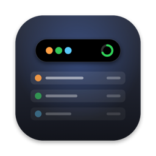
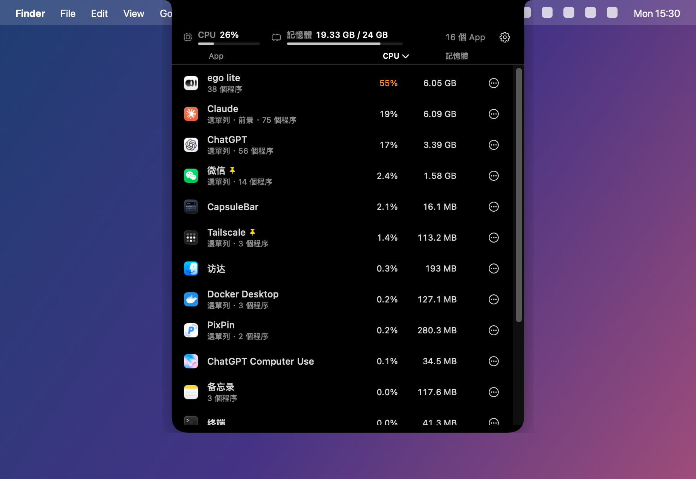
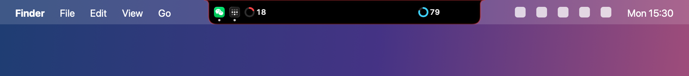
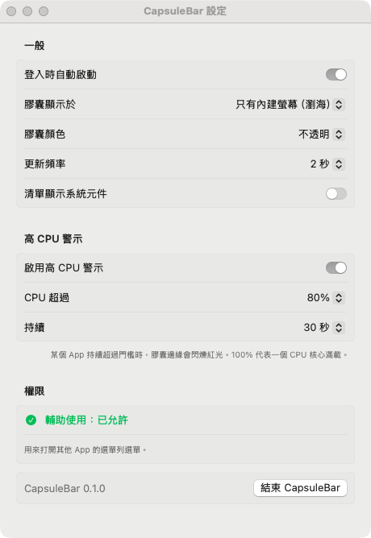

<p align="center">
  
</p>

<h1 align="center">CapsuleBar</h1>

<p align="center">
  貼著 MacBook 瀏海的「動態島」膠囊——看一眼系統負載，點一下管理所有正在執行的 App。<br>
  A Dynamic-Island-style capsule around the MacBook notch for monitoring and controlling running apps.
</p>

<p align="center">
  
</p>

## 為什麼做這個

MacBook 螢幕窄又有瀏海，常駐程式一多，右上角的選單列圖示就會被擠到瀏海後面，看不到也點不到。CapsuleBar 不搬動那些圖示，而是在瀏海周圍放一顆小膠囊：

- 平時顯示 **CPU、記憶體** 和你 **釘選的常用 App**
- 點一下展開，列出 **所有正在執行的 App** 與各自的 CPU / 記憶體佔用
- 直接 **結束、強制結束、重新啟動、切換、隱藏**，或 **打開它原本的選單列選單**（即使圖示被瀏海擋住）

## 截圖

<p align="center">
  
</p>

| 高 CPU 警示 | 設定 |
|---|---|
|  某個 App 持續超過門檻時，膠囊邊緣閃紅光，清單中該列標紅。 |  |

## 功能

| | |
|---|---|
| 🫧 **動態島膠囊** | 有瀏海的螢幕包住瀏海；外接螢幕置中於選單列。可選顯示在哪些螢幕。毛玻璃半透明，四段濃淡可調。 |
| 📊 **資源監控** | 每個 App 的 CPU % 與記憶體（含所有子程序與 bundle 內 helper 加總，算法與「活動監視器」一致）。 |
| 🎛 **程式控制** | 切換到前景、隱藏、結束、強制結束（需確認）、重新啟動。 |
| 📌 **釘選** | 最多 4 個常用 App 釘在膠囊上：左鍵切換／開啟，**右鍵打開它的選單列選單**。 |
| 🧭 **選單列程式** | 右鍵點膠囊，列出所有有選單列圖示的 App，點一下就打開它的選單——被瀏海擋住的也可以。 |
| 🔥 **高 CPU 警示** | 門檻（50%–200%）與持續時間（10 秒–3 分鐘）可調。 |
| ⚙️ **設定** | 登入時自動啟動、更新頻率、顯示系統元件、權限狀態。 |

## 操作

- **左鍵點膠囊**：展開／收合所有程式清單；點外面任何地方收合
- **右鍵點膠囊**：選單列程式清單
- **清單中的 App**：點名稱切換過去；右鍵或「⋯」開啟操作選單；滑鼠移上去出現 ⊗ 可直接結束
- **設定**：展開 → 右上角齒輪 → 設定…

## 系統需求

- macOS 14 Sonoma 以上
- **Apple 晶片與 Intel 都支援**（Universal 通用二進位）。Intel Mac 沒有瀏海，膠囊會置中顯示在選單列上。

## 安裝

### 方法一：DMG 安裝檔

1. 下載 `CapsuleBar-<版本>.dmg`，打開後把 **CapsuleBar** 拖進 **應用程式**。
2. 第一次打開時，macOS 可能顯示「無法驗證開發者」——目前的版本尚未經 Apple 公證。請到 **系統設定 › 隱私權與安全性**，在下方按 **強制打開**（或在 Finder 對 App 按右鍵 › 打開）。
   也可以在終端機執行：`xattr -dr com.apple.quarantine /Applications/CapsuleBar.app`

自己產生 DMG：

```bash
scripts/make-dmg.sh      # 產生 build/CapsuleBar-<版本>.dmg（Universal）
```

### 方法二：從原始碼建置

需要 Xcode（Swift 5.9+）。

```bash
git clone https://github.com/tonywei49/CapsuleBar.git
cd CapsuleBar
scripts/build-app.sh                 # 產生 build/CapsuleBar.app
ditto build/CapsuleBar.app /Applications/CapsuleBar.app
open /Applications/CapsuleBar.app
```

第一次使用「打開選單列選單」時，到 **系統設定 › 隱私權與安全性 › 輔助使用** 允許 CapsuleBar。

> 建置腳本預設產生 Universal（arm64 + x86_64）版本，只要本機架構可用 `CAPSULE_ARCHS=arm64 scripts/build-app.sh` 加快建置。簽名會自動使用鑰匙圈中的 Apple Development 憑證（也可用 `CAPSULE_SIGN_ID` 指定）；沒有憑證時使用 ad-hoc 簽名，此時每次重新建置都需要重新授予輔助使用權限。

## 為什麼不上架 App Store

打開其他 App 的選單列選單需要「輔助使用」權限，App Store 的沙盒不允許，所以 CapsuleBar 以原始碼／自行簽名方式發布。

## 開發

| 檔案 | 內容 |
|---|---|
| `Sources/CapsuleBar/ProcessSampler.swift` | libproc 取樣、把子程序歸戶到 App |
| `Sources/CapsuleBar/ProcessMonitor.swift` | App 清單、選單列圖示偵測、高 CPU 追蹤 |
| `Sources/CapsuleBar/CapsuleController.swift` | 膠囊視窗、展開／收合、右鍵、指令 |
| `Sources/CapsuleBar/Views.swift` | SwiftUI 介面 |
| `Sources/CapsuleBar/Settings.swift` | 設定與設定視窗 |
| `scripts/build-app.sh` | 建置並簽名 `build/CapsuleBar.app` |
| `scripts/make-dmg.sh` | 打包 DMG 安裝檔 |
| `scripts/make-icon.swift` | 以程式繪製 App 圖示 |
| `SPEC.md` | 規格書 |

除錯參數（直接傳給 App，例如 `open build/CapsuleBar.app --args --selftest`）：

| 參數 | 作用 |
|---|---|
| `--expanded` | 啟動後自動展開主螢幕的膠囊 |
| `--settings` | 啟動時打開設定視窗 |
| `--snapshot DIR` | 輸出膠囊、展開面板、設定視窗截圖與 `report.txt` 後結束 |
| `--selftest` | 用「計算機」測試啟動／重新啟動／結束／強制結束後結束 |
| `--axprobe` | 列出哪些 App 有可透過輔助使用打開的選單列圖示 |
| `--rightclick-test` | 送出真實右鍵事件測試膠囊與釘選圖示（會短暫移動游標） |
| `--enable-login-item` | 將這份 App 註冊為登入項目 |

> 從終端機直接執行執行檔時，輔助使用權限會算在終端機上；測試權限相關功能請用 `open`。

## 已知限制

- 收合時的翅膀可能蓋住最靠近瀏海的幾個選單列圖示。
- 全螢幕 App 時，外接螢幕上的膠囊仍會蓋在畫面頂端。
- 尚未使用 Developer ID 簽名與公證，下載後第一次打開需要手動允許（見「安裝」）。

## 授權

[MIT](LICENSE)
